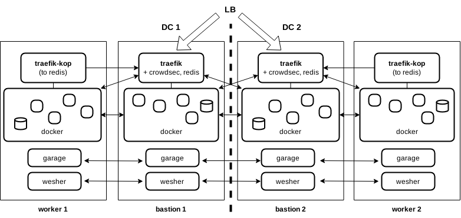

# autoops

A multi-region data and service mesh operated by a Makefile. Designed for horizontal scalability across 150–200 nodes with minimal dependencies and strict supply-chain control.



## Quickstart

You need two or more Debian hosts with root SSH access, and `python3`, `make` and `curl` on your machine; pyinfra runs from there.

```bash
python3 -m venv .venv && . .venv/bin/activate && pip install -r requirements.txt
make assets                                  # wesher, garage, traefik-kop for x86_64 + aarch64, checksummed
cp examples/inventory.py inventory.py        # your hosts: IPs, ssh_user / ssh_port / ssh_key, hostname, zone
make FIRST_IP="203.0.113.10" nodes           # base system + firewall, docker, overlay network, s3 cluster
export REDIS_PWD="$(openssl rand -hex 16)"   # shared by redis on the bastion and traefik-kop on the workers
export DOMAIN="203-0-113-10.sslip.io"        # any name pointing at the bastion; sslip.io works without your own domain
make DOCKERFILES_PATH="examples/dockerfiles" services
make services-up
curl https://$DOMAIN/                        # whoami on the worker, routed by traefik on the bastion over the overlay, Let's Encrypt cert
```

- `FIRST_IP` is the node the mesh is bootstrapped from, here the bastion.
- `make nodes` prints the S3 access key for the `autoops` bucket once. Save it, and keep `REDIS_PWD` for later `services` runs.
- `basic.py` enables ufw with incoming traffic denied. It opens the inventory's `ssh_port` (default 22) first, then HTTP(S), wesher (7946, 51820) and everything on the overlay interface. Garage listens on the overlay only.
- `make check` compiles the modules without touching any host.
- Downloads use `curl`, so `ALL_PROXY` works for them, e.g. `ALL_PROXY=socks5h://127.0.0.1:9050 make assets`.

## Architecture

- **Scalability**: Horizontally scalable services within a mesh designed for up to 150–200 nodes.
- **Core Mesh Services**:
  - `wesher`: WireGuard mesh overlay network.
  - `garage`: Distributed S3-compatible object storage.
  - Docker, Traefik, Redis, and `traefik-kop`.
- **Service Discovery**: Managed by Traefik and Redis (on bastion hosts) and `traefik-kop` (on worker nodes). `traefik-kop` reads the `traefik.*` labels of the local containers and writes routers and services, with the worker's overlay IP as backend, into the bastion's Redis; Traefik uses that Redis as its provider. Redis listens on the overlay IP only.
- **High Availability**: Multiple parallel Traefik/Bastion hosts ensure redundancy.
  - **Ingress**: Handled by a load balancer, VPS providers (floating IPs across DCs) or DNS servers with health checks.
  - **Stateless Design**: Identical Traefik configurations and shared backend access eliminate the need for synchronized state between instances.
  - **No Redis Sync**: Set `traefik_host` to a list of bastions; every worker then runs one `traefik-kop@<bastion>` per bastion and publishes its routes to each bastion's Redis, so any bastion can take the traffic.
- **Performance**: On two 1-vCPU cloud VMs, one bastion served about 1,200–1,600 HTTPS req/s to a minimal backend, the overlay added well under 1 ms of latency, and losing a worker or restarting Traefik caused a few seconds of errors at most. Real services will usually be the bottleneck before the mesh is.
- **Bootstrapping**: The mesh is initialized from a single node marked by the `FIRST_IP` environment variable. This IP is used only during setup to bootstrap WireGuard and Garage connections. All other traffic routes through overlay IPs. `wesher.py` and `garage.py` can verify or update the first node IP via DNS. Hosts are prepared in parallel; the other nodes wait for the first one, and `garage-layout.py` applies the storage layout once all nodes have joined.

## Supply Chain

- `docker.py`: Avoids external APT repositories by downloading packages directly from the official website.
- `services.py`: Avoids Docker Hub by building containers from local Dockerfiles. Their base images still come from a registry; the examples use official images, point `FROM` at your own registry or mirror if needed.
- `make assets`: Pinned releases, checked against `assets/SHA256SUMS`.

## Usage

### 1. Prepare
- Define inventory in `inventory.py` (refer to Pyinfra documentation; start from `examples/inventory.py`).
- Create a `dockerfiles/` directory (see `examples/dockerfiles`) containing:
  - Subdirectories for each service with a `Dockerfile` and build assets.
  - A `<group>.yml` Docker Compose file for each group in `inventory.py` (e.g. `bastion.yml`, `worker.yml`).

### 2. Deploy
```bash
# Bootstrap nodes and mesh
make FIRST_IP="x.x.x.x" nodes

# Build services from local Dockerfiles (plus the variables your compose files use, e.g. REDIS_PWD)
make DOCKERFILES_PATH="../dockerfiles" services

# Start services
make services-up
```

### 3. Maintain
- **Rebuild a specific container** on all hosts that run it:
  ```bash
  make SERVICE="whoami" deploy
  ```
- **Update/Upgrade APT packages** for specific host groups (e.g., `db*`):
  ```bash
  make GROUP="db*" care
  ```
- `GROUP` limits every target to matching hosts or groups.

## Modules & Configuration

### Prerequisites
- Debian-based system with `apt` and `systemd`.
- Prebuilt binaries located in `assets/aarch64` and `assets/x86_64`: `wesher`, `garage`, `traefik-kop`. `make assets` downloads the pinned releases and checks them against `assets/SHA256SUMS`.
- pyinfra 2 (`requirements.txt`), which still runs on older system Pythons such as macOS's 3.9.

### Inventory Attributes
- **`hostname`** (string): Set as the system hostname; used for hostname resolution within the overlay network.
- **`behind_nat`** (bool): Enables LAN service sharing via a Bastion node (Tailscale-like functionality).
  - Requires `wesher --advertise-addr`, which upstream wesher does not have: build [neospe/wesher](https://github.com/neospe/wesher) yourself and replace `assets/<arch>/wesher`.
  - Any node can be behind NAT, including the first node. Requires `public_ip` and SSH port forwarding.
  - Supports DynDNS by resolving `public_dns` during setup steps requiring public routable addresses.
- **`services`** (list): Service names corresponding to subdirectories in `DOCKERFILES_PATH`.
  - If you have pet servers rather than cattle, put every host in its own group, each of which has its own compose YAML.
  - **Traefik**: Requires `'traefik'` in the services list OR a `traefik_host` attribute (the inventory name of a bastion, or a list of them). If neither is present, `services.py` stops with a notice.
- **`zone`**: Defines Garage data replication zones. `assets/garage.toml` keeps 2 copies of everything (`replication_factor`); optimal is a minimum of 3 nodes across 3 locations.
- **SSH Configuration**: pyinfra's connection settings per host: `ssh_user`, `ssh_port` and `ssh_key` (path to the private key; `ssh_key_password` if it has one).
  - Without `ssh_key`, pyinfra uses your SSH agent and the default keys in `~/.ssh`.
  - Hosts never connect to each other over SSH; everything goes through your machine. Other credentials may be handled via a vault (refer to Pyinfra documentation).

### Services
- **Assumptions**:
  - `DOCKERFILES_PATH` is defined in the environment or Makefile.
  - Structure: `DOCKERFILES_PATH/<service>/Dockerfile` and `DOCKERFILES_PATH/<inventory-group>.yml`.
- **Variables**: The group compose file can contain templated variables: `<< OVERLAY_IP >>` and `<< HOSTNAME >>` are filled in per host, everything else comes from the environment (or another secrets handling system feeding it). Examples: `<< GARAGE_KEY >>`, `<< GARAGE_SECRET >>`, `<< REDIS_PWD >>`, `<< POSTGRES_PWD >>`, `<< SMTP_PWD >>`.
- **Traefik**: Includes CrowdSec integration (with Docker-specific config). Debian's `crowdsec-firewall-bouncer` package runs in nftables mode, which covers host-network containers; the packagecloud package runs in iptables mode, for which the bouncer is added to the `DOCKER-USER` chain.
- **traefik-kop**: Requires Redis running on each `traefik_host`, reachable over the overlay, and the same `REDIS_PWD` when running `services`. Its settings, including the password, are in `/etc/traefik-kop/<bastion>.env` (root only). It is started by `services-up`.
- **Health checks**: Give each service a Traefik health check via labels (see `examples/dockerfiles/worker.yml`); a worker that stops answering is then out of rotation within seconds instead of running requests into timeouts.
- **One service on several workers**: add the label `kop.merge-lbs=true`, so traefik-kop appends each worker to the service's load balancer instead of replacing it.
- **TLS**: The example bastion gets certificates from Let's Encrypt (HTTP challenge, stored in `/containers/traefik/acme.json`) for the `Host()` rules of the published routers, and redirects HTTP to HTTPS.
- **Docker**: Uses host network mode. Services are configured to run on the overlay network. `services.py` dynamically injects overlay hostname and IP into Compose files (see Variables).

### Deployment Notes
- The `deploy` target builds the new image on all hosts in parallel, then swaps the containers one host at a time and waits until each new container runs (and is healthy, if it has a healthcheck). A service on several hosts stays reachable; on a single host it is gone for a second or two.
- The `deploy` target strictly rebuilds containers; it does not update Dockerfiles or assets. Assumes Dockerfiles pull updates from internal version control or object stores.
- To update Dockerfiles: Run `make DOCKERFILES_PATH="../dockerfiles" services`.

## Extendability

- (Almost) Full ARM64 Support:
  - `docker.py` and the binaries in `assets/` cover x86_64 and aarch64.
  - `services.py`: Debian's `crowdsec-firewall-bouncer` package covers both; the packagecloud fallback is amd64 only (alternative: [cs-firewall-bouncer-armv7](https://github.com/frigori/cs-firewall-bouncer-armv7)).

- Extend `services.py`
  - Environment Injection: Inject variables into Dockerfiles and assets as well (compose files already get them).
  - Database State: Restore Postgres and Redis state.
  - _Note_: `chown` operations require UID/GID from inside the container context.

- Extend `deploy.py`
  - Graceful Rollouts on one host: `docker-rollout` (scale up, drain, remove the old container) needs bridge networking and no `container_name`, so it does not fit host network mode.
  - Cache Clearing: Clears caches for Traefik and web services (add your webapp logic here).

- Maintenance (`care`)
  - Add custom backup routines in the `care.py` module.

- Logging
  - All logs are centralized under `/containers/log`. Easily monitored using tools like `lnav`.

- Unprivileged Services
  - Wesher
     - Can run as an unprivileged user.
     - Edit `wesher.service`: Set `User` and `Group`.
     - Assign binary capabilities: `setcap cap_net_admin=eip wesher`.
     - *Note*: Hosts file updates require root privileges. Alternative: Sync Wesher state to `/etc/hosts` via a separate task in `care.py`.
  - Garage
     - Configure `garage.toml`: Set `metadata_dir=/var/lib/garage/meta` and `data_dir=/var/lib/garage/data`.
     - Configure `garage.service` (`[Service]` section):
       ```ini
       StateDirectory=garage
       DynamicUser=true
       ProtectHome=true
       NoNewPrivileges=true
       LimitNOFILE=42000
       ```
  - Docker
     - Rootless containers.

- Roadmap
  - Services: Generate Compose files dynamically from snippets and inventory service definitions.
  - Inventory: Model in CUE.
  - Logging: Implement a log collection service forwarding to a Grafana host.
  - Secrets Management: Integrated secrets handling system.

## Limits

- The overlay is one trusted network: every node reaches every service on every other node.
- Host network mode: no isolation between containers on a host, and services on one host need distinct ports.
- No real dry run: the modules run commands on the hosts while pyinfra prepares the deploy, so `pyinfra --dry` still changes things.
- Removing a node is manual (`garage layout remove`, stop wesher).
- Monitoring: the logs in `/containers/log`, read with `lnav` over SSH; no metrics or alerting.
- Backups: data in Garage is replicated across zones, but replication is not a backup (deletions replicate too); keep an offsite copy, e.g. via rsync.
- Supply chain: `assets/SHA256SUMS` was pinned on first download (Garage publishes no checksums); Docker packages are pinned by version; base images come from a registry.
- pyinfra 2: pyinfra 3 needs Python 3.10+ and API changes in every module.
